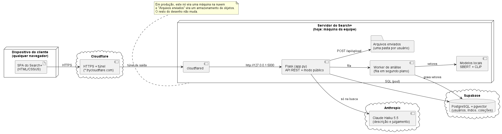

# Search+ como SaaS

**Em uma frase:** o Search+ é um MVP de SaaS. O cliente usa pelo navegador,
por um link HTTPS, com conta própria e dados isolados. O servidor roda hoje
numa máquina da equipe, e o caminho para a nuvem já está desenhado (seção 5).



Fonte do diagrama: [`16-implantacao-saas.puml`](16-implantacao-saas.puml).

## 1. O que já é SaaS hoje

| Característica de um SaaS | No Search+ | Evidência |
|---|---|---|
| Acesso pelo navegador, pela internet, sem instalar nada | Link HTTPS público (Cloudflare Tunnel) | Seção 4 |
| A equipe opera o software; o cliente só usa | Servidor, banco, modelos e IA ficam do lado da equipe | Diagrama acima |
| Várias contas no mesmo sistema, dados isolados | Toda consulta filtra por `user_id`; arquivo de outra conta responde 404 | `tests/unit/test_endpoints_dados.py`, `test_colecao_lote.py`, `test_lixeira.py` |
| Arquivos chegam pela web | `POST /api/upload`: o cliente envia do próprio dispositivo | `tests/unit/test_modo_publico.py` |
| O servidor protege a si mesmo | Modo público: cadastro fechado e nada que toque no disco do servidor | [`API.md` → Modo público](API.md#modo-público) |
| API documentada, frontend substituível | 58 rotas com contrato e servidor mock | [`API.md`](API.md), [`FRONTEND.md`](FRONTEND.md) |
| Aguenta vários usuários ao mesmo tempo | Pool de conexões; teste de carga com 150 usuários e 0 falhas | [`TESTING.md`](TESTING.md) |
| Entrega contínua com qualidade | CI com 6 jobs e portão de qualidade a cada push | [`07-git-fluxo.md`](07-git-fluxo.md) |
| Modelo de assinatura | Planos Grátis, Pro e Equipes na landing page | Seção 3 |

## 2. O que ainda não é

Dito com todas as letras, para não haver surpresa:

- **O servidor é uma máquina da equipe**, não um data center. Se ela desligar,
  o serviço para. É a fase de MVP: o software já está pronto para ser movido,
  e a mudança é de onde ele roda, não de como funciona.
- **A cobrança não está implementada.** Os planos são o modelo de negócio
  proposto; enquanto o projeto é acadêmico, o uso é gratuito.
- **O link muda** cada vez que o túnel é religado (domínio provisório do
  Cloudflare). Com domínio próprio, ele passa a ser fixo.

## 3. Modelo de negócio

O custo que cresce com o uso é a IA. A arquitetura foi desenhada para mantê-lo
baixo:

- **Analisar os arquivos não custa nada:** os vetores (SBERT e CLIP) são
  gerados por modelos locais, sem chamar serviço pago.
- **A IA só trabalha na busca:** no máximo 5 descrições de imagem e 1
  julgamento de relevância por busca.
- **Cada descrição é feita uma vez só**, guardada no banco e reaproveitada.

Por isso o plano grátis pode ser generoso e o pago cobre o uso intenso:

| Plano | Preço | Para quem | Limites |
|---|---|---|---|
| Grátis | R$ 0 | Acervo pessoal | 2.000 arquivos, 100 buscas com conferência da IA por mês |
| Pro | R$ 19,90/mês | Fotógrafos, criadores | 100.000 arquivos, buscas com IA sem limite, exportação |
| Equipes | R$ 14,90/usuário/mês | Escritórios, equipes | Tudo do Pro, coleções compartilhadas, gestão de acessos |

Preços de lançamento planejados, ainda não validados com clientes.

## 4. Como a versão on-line funciona hoje

1. O Search+ roda com `SEARCHPLUS_MODO_PUBLICO=1`, o **modo público**.
2. O `cloudflared` abre um túnel de saída até o Cloudflare, que publica um
   endereço `https://….trycloudflare.com`. Nenhuma porta do roteador é aberta.
3. Quem abre o link entra com uma conta já criada (o cadastro fica fechado) e
   envia os arquivos pelo navegador. Eles caem numa pasta própria da conta e
   entram na fila de análise na hora.
4. A busca, a galeria, as coleções e os favoritos funcionam como no app local.

**O que o modo público bloqueia, e por quê:** num servidor aberto, cadastrar
`C:\` como pasta deixaria qualquer conta ler qualquer arquivo da máquina,
inclusive a senha do banco. Por isso ficam desligados o cadastro de pastas do
servidor, a exportação para pastas, as janelas do Windows, a configuração do
Claude e as rotas de diagnóstico. A lista completa está em
[`API.md`](API.md#modo-público), e cada bloqueio tem teste.

### Como ligar

Em dois terminais (PowerShell), na pasta do projeto:

```powershell
# Terminal 1 — o Search+ em modo público
$env:SEARCHPLUS_MODO_PUBLICO = "1"
py backend/app.py
```

```powershell
# Terminal 2 — o túnel; copie o endereço https://….trycloudflare.com que ele mostrar
cloudflared tunnel --url http://127.0.0.1:5000
```

O `cloudflared` instala com `winget install Cloudflare.cloudflared`. As contas
de acesso são criadas antes, com o servidor fora do modo público.

Configurações opcionais:

| Variável | Padrão | Para quê |
|---|---|---|
| `SEARCHPLUS_PASTA_ENVIOS` | `~/SearchPlus/Enviados` | Onde ficam os arquivos enviados (fora da pasta do projeto, que é servida) |
| `SEARCHPLUS_MAX_ENVIO_MB` | `100` | Tamanho máximo por envio (o plano grátis do Cloudflare aceita até 100 MB) |

## 5. Caminho para produção

Em ordem, cada passo independente do seguinte:

1. **Servidor na nuvem.** Mover o mesmo app para uma máquina virtual com 4 GB
   de RAM ou mais (os modelos locais ocupam ~1,6 GB), com domínio próprio e
   HTTPS. Candidatos: Oracle Cloud Always Free (gratuito, 12 GB de RAM) ou uma
   VPS de baixo custo.
2. **Arquivos fora do disco.** Trocar a pasta de envios por armazenamento de
   objetos (o Supabase Storage, do mesmo provedor do banco), para o servidor
   poder ser recriado sem perder nada.
3. **Claude pela API.** O modo assinatura serve para uso pessoal do dono da
   conta; com clientes, o Claude é chamado pela API, com a chave da empresa.
4. **Cobrança e limites por plano.** Integração com um meio de pagamento
   (Stripe ou Mercado Pago) e contagem de arquivos e buscas por conta.
5. **LGPD.** Termos de uso, consentimento para o envio de imagens à IA,
   exportação e exclusão da conta.
6. **Agente local (opcional).** Um programa leve no computador do cliente que
   analisa as pastas sem enviar os arquivos. Isso mantém a proposta de
   privacidade da landing page para quem não quer subir o acervo.
7. **Operação.** Monitoramento, backups do banco e alertas.
